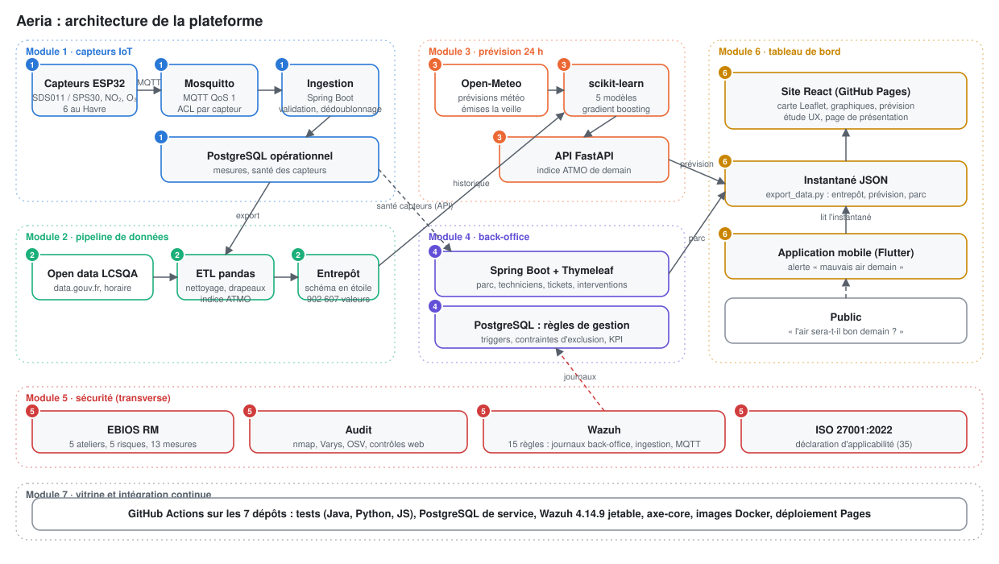

# Aeria — open air-quality monitoring for Normandy

[](https://github.com/brinis-aya/aeria/actions/workflows/ci.yml)

**Will the air be good tomorrow?** Aeria answers that question for Normandy, end to end: low-cost sensors
over MQTT, official open data, a data warehouse, a next-day forecast of the French ATMO index, a maintenance
back-office, a security analysis and a public dashboard. It is an open, tested, documented student project,
split into seven modules.

**▶ Live dashboard: <https://brinis-aya.github.io/aeria-dashboard/>**



## How to test (for reviewers)

| Time | What | How |
|---|---|---|
| 1 min | The public dashboard | open <https://brinis-aya.github.io/aeria-dashboard/>: map, a station page, tomorrow's forecast |
| 15 min | **The whole platform** | Docker Desktop (4 GB RAM free, ports 1883, 8081, 8083, 8084 free), then `git clone https://github.com/brinis-aya/aeria && cd aeria && docker compose up --build`. The first build downloads and compiles every module (10–15 min). |
| | then | back-office <http://127.0.0.1:8084> (`responsable` / `demo-responsable`), forecast API <http://127.0.0.1:8083/docs>, live sensor readings <http://127.0.0.1:8081/api/sensors> |
| 5 min each | One module on its own | each repository's README has a **quick test** section (tests and demo, no other module needed) |
| 0 min | Automated proof | the green badges below: every repository runs its tests on each push, and this repository rebuilds the whole platform from GitHub and checks that the modules talk to each other |

Each module's report (`docs/rapport.md`, in French) states its results **and its limits**.

## Modules

| # | Repository | What it does | Stack | CI |
|---|---|---|---|---|
| 1 | [aeria-iot-sensors](https://github.com/brinis-aya/aeria-iot-sensors) | ESP32 sensors and simulator publish over MQTT; a service validates and stores readings | Spring Boot, Eclipse Paho, Mosquitto, PostgreSQL, Docker | [](https://github.com/brinis-aya/aeria-iot-sensors/actions) |
| 2 | [aeria-data-pipeline](https://github.com/brinis-aya/aeria-data-pipeline) | One year of official LCSQA open data plus sensor readings, cleaned and loaded into a star-schema warehouse | pandas, PostgreSQL | [](https://github.com/brinis-aya/aeria-data-pipeline/actions) |
| 3 | [aeria-forecast](https://github.com/brinis-aya/aeria-forecast) | Next-day ATMO index forecast with clear metrics, served by an API | scikit-learn, FastAPI, Open-Meteo | [](https://github.com/brinis-aya/aeria-forecast/actions) |
| 4 | [aeria-backoffice](https://github.com/brinis-aya/aeria-backoffice) | Sensor fleet, technicians and maintenance; Merise model, rules in SQL, BPMN processes | Spring Boot, Thymeleaf, PL/pgSQL, BPMN 2.0 | [](https://github.com/brinis-aya/aeria-backoffice/actions) |
| 5 | [aeria-security](https://github.com/brinis-aya/aeria-security) | EBIOS RM risk analysis, audit with fixes re-tested, Wazuh detection rules, ISO 27001 statement of applicability | nmap, Varys, Wazuh, OSV | [](https://github.com/brinis-aya/aeria-security/actions) |
| 6 | [aeria-dashboard](https://github.com/brinis-aya/aeria-dashboard) | UX case study and React dashboard: map, charts, forecast, presentation page | React, Leaflet, Recharts, Vite, GitHub Pages | [](https://github.com/brinis-aya/aeria-dashboard/actions) |
| 7 | **aeria** (this repo) | Overview, architecture, one-command platform, integration CI, demo video | Docker Compose, GitHub Actions | ↑ |

Every module has an English README and a full report in French (`docs/rapport.md`).

## Results

| | |
|---|---|
| Real data | **902,607** hourly values from 36 reference stations, Nov 2025 → Nov 2026, 95.7 % usable after cleaning |
| Forecast | right ATMO index for tomorrow **83.1 %** of the time vs 79.6 % for "same as today", in a leak-free rolling backtest |
| Maintenance | one simulated year: 99.5 % sensor availability, MTBF, SLA and costs computed in SQL views |
| Security | 10 audit findings; the 6 most serious fixed in the modules and re-tested before/after; 15 Wazuh rules, 15/15 attack scenarios detected |
| Quality | about 140 automated tests across the modules; the CI of this repo rebuilds the whole platform from the repositories and checks it end to end |

## Run the platform

```bash
git clone https://github.com/brinis-aya/aeria.git && cd aeria
docker compose up --build        # builds every module from its GitHub repository
```

| Service | URL |
|---|---|
| Back-office (module 4) | <http://127.0.0.1:8084> (demo accounts: see its README) |
| Forecast API (module 3) | <http://127.0.0.1:8083/docs> |
| Sensor ingestion (module 1) | <http://127.0.0.1:8081/api/sensors> |
| Dashboard (module 6) | <https://brinis-aya.github.io/aeria-dashboard/> (static) |

Everything is published on `127.0.0.1` only: that is one of the security module's findings.

## How the modules fit together

1. Sensors publish every few minutes over MQTT. The ingestion service rejects impossible readings and stores
   the rest (module 1).
2. Each day, the pipeline downloads the official measurements, cleans both sources, computes the ATMO index
   and loads the warehouse (module 2).
3. The forecast model learns from the warehouse and from the weather forecasts issued the day before, then
   serves tomorrow's index (module 3).
4. The back-office watches the sensors' health through module 1's API, opens tickets, and plans the
   interventions and calibrations (module 4).
5. The dashboard publishes a snapshot of modules 2, 3 and 4 as a static site (module 6).
6. The security module analyses the risks of the whole chain, audits it, fixes it and watches it with
   Wazuh (module 5).

## Demo video

The 2-minute script, shot list and CapCut editing guide are in [`docs/video/script.md`](docs/video/script.md).

## Certifications (in progress)

Free certifications that back the skills used in the project:

| Certification | Issuer | Workload | Related module | Status |
|---|---|---|---|---|
| SecNumacadémie | ANSSI (French cybersecurity agency) | ~20 h | 5 · security | in progress |
| Elements of AI | University of Helsinki | ~30 h | 3 · forecast | in progress |
| Introduction to Cybersecurity | Cisco Networking Academy | ~6 h | 5 · security | in progress |

Certificates will be linked here once obtained.

## Report

[`docs/rapport.md`](docs/rapport.md) (French): the project as a whole, what each module brought, lessons learnt,
limits.

## Author

BRINIS Aya. Licence MIT. Data: LCSQA / Geod'air (Licence Ouverte 2.0), Open-Meteo (CC BY 4.0), map ©
OpenStreetMap contributors.
